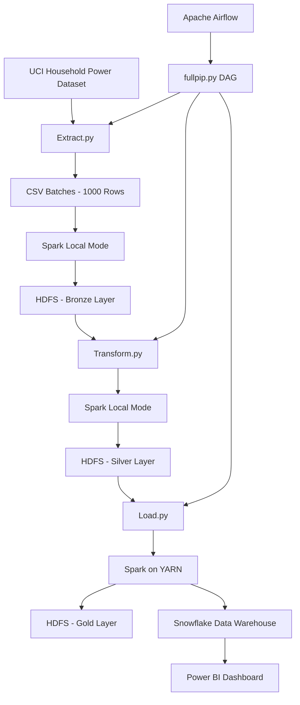

# Power Consumption ETL Pipeline

**An end-to-end batch data engineering pipeline for household electricity consumption analytics.**

<p align="center">
  
  
  
  
  
  
</p>

<p align="center">
  <a href="https://github.com/yousef-140/power-consumption-etl">Repository</a> ·
  <a href="https://archive.ics.uci.edu/dataset/235/individual+household+electric+power+consumption">Dataset</a> ·
  <a href="https://yousef-140.github.io/">Portfolio</a>
</p>

---

## Overview

This project implements an end-to-end batch ETL pipeline for processing household electricity consumption data and preparing analytics-ready datasets.

The pipeline combines Apache Airflow for workflow orchestration, Apache Spark for data processing, HDFS for data lake storage, and Snowflake as the analytical data warehouse.

The resulting datasets follow a Bronze, Silver, and Gold architecture and are designed to support electricity consumption analysis and Power BI reporting.

## Architecture



**Execution model:**

- Apache Airflow orchestrates the three ETL tasks.
- The DAG uses Docker commands to execute the Python scripts inside the `spark-jupyter` container.
- Extract and Transform use Spark in `local[*]` mode.
- Load uses Spark with YARN as its execution master.

Note: Spark Local Mode means processing runs locally within the Jupyter container, not directly on the host machine.

## Technology Stack

| Technology | Purpose |
|---|---|
| Python | ETL development and scripting |
| Apache Airflow | Workflow orchestration and scheduling |
| Apache Spark | Data processing and transformation |
| PySpark | Spark processing through Python |
| HDFS | Distributed data lake storage |
| YARN | Cluster resource management for the loading stage |
| Snowflake | Analytical data warehouse |
| Docker Compose | Infrastructure orchestration |
| PostgreSQL | Airflow metadata database |
| Parquet | Columnar data storage |
| Power BI | Data visualization and reporting |

## Data Engineering Workflow

### 1. Extraction — Bronze Layer

Implemented in `dags/extract.py`.

- Reads the original household electricity consumption dataset.
- Splits the input records into batches of 1,000 rows using Pandas.
- Stores intermediate batches as CSV files.
- Uses Spark to read the generated CSV batches.
- Writes the extracted dataset to HDFS in Parquet format.

**Output:**

`/user/root/datalake/bronze/power_consumption`

### 2. Transformation — Silver Layer

Implemented in `dags/transform.py`.

Spark reads the Bronze Parquet dataset and applies data cleaning and feature engineering.

Main operations include:

- Handling missing and invalid values.
- Converting measurement columns into numeric types.
- Parsing date and time values into timestamps.
- Removing records with missing required measurements or timestamps.
- Extracting temporal features:
  - Hour
  - Day
  - Month
  - Year
  - Day of week
- Calculating total sub-metering consumption.
- Creating weekend and peak-hours indicators.

**Output:**

`/user/root/datalake/silver/power_consumption`

### 3. Loading — Gold Layer

Implemented in `dags/load.py`.

Spark runs on YARN to prepare analytical datasets from the Silver layer.

Two datasets are created:

**FACT_POWER**

Contains electricity consumption measurements:

- Event timestamp
- Global active power
- Global reactive power
- Voltage
- Global intensity
- Sub-metering measurements
- Total sub-metering consumption

**TIME_DIM**

Contains time-related attributes:

- Event timestamp
- Hour
- Day
- Month
- Year
- Day of week
- Weekend indicator

Both datasets are stored in HDFS as Parquet files and loaded into Snowflake using the Snowflake Spark Connector.

## Data Lake Architecture

| Layer | Description | Storage Format |
|---|---|---|
| Bronze | Extracted source records | Parquet |
| Silver | Cleaned and enriched records | Parquet |
| Gold | Analytical fact and time datasets | Parquet |

This layered architecture separates ingestion, transformation, and analytical data preparation.

## Workflow Orchestration

The main Airflow DAG is:

`power_consumption_etl_full_pipeline`

Defined in `dags/fullpip.py`.

The DAG contains three sequential tasks:

```text
Extract → Transform → Load
```

Each task executes its corresponding Python script inside the `spark-jupyter` Docker container.

Airflow is responsible for orchestration and scheduling, while Spark handles the data processing.

## Infrastructure

The Docker Compose environment includes:

- **Apache Airflow:** Webserver, Scheduler, and Triggerer.
- **Apache Spark / Jupyter:** PySpark execution environment.
- **HDFS:** NameNode and two DataNodes.
- **YARN:** ResourceManager and two NodeManagers.
- **PostgreSQL:** Airflow metadata database.

The infrastructure provides the environment for running and coordinating the ETL workflow.

## Dashboard & Analytics

A Power BI dashboard accompanies the project to explore household electricity consumption patterns.

The analysis includes:

- Average power consumption by month.
- Electricity consumption by hour.
- Weekend versus weekday comparisons.
- Year-based filtering.

The dashboard export is available in the repository as a PDF file.

## Dataset

**UCI Individual Household Electric Power Consumption Dataset**

Source: [UCI Machine Learning Repository](https://archive.ics.uci.edu/dataset/235/individual+household+electric+power+consumption)

The dataset contains household electricity consumption measurements collected over time.

The original dataset is approximately 126 MB and is not committed to this repository.

Expected input path:

```text
data/source/household_power_consumption.txt
```

Generated CSV batches are stored under `data/raw_power_batches/` and excluded from Git tracking.

## Repository Structure

```text
power-consumption-etl/
│
├── dags/
│   ├── fullpip.py       # Main Airflow DAG
│   ├── extract.py       # Data extraction
│   ├── transform.py     # Data cleaning and transformation
│   └── load.py           # Gold layer and Snowflake loading
│
├── data/
│   └── raw_power_batches/  # Generated CSV batches (gitignored)
│
├── logs/                  # Airflow logs (gitignored)
├── notebooks/             # Development notebooks
│
├── docker-compose.yaml    # Docker infrastructure
├── pipeline_diagrams.md   # Architecture diagrams
├── dashboard .pdf         # Power BI dashboard export
├── test.py                # Project test script
├── .gitignore
└── README.md
```

## Key Engineering Concepts

This project demonstrates practical experience with:

- Batch data ingestion.
- ETL workflow orchestration.
- Apache Spark Local Mode and YARN execution.
- HDFS-based data lake storage.
- Bronze, Silver, and Gold data organization.
- Parquet data processing.
- Data cleaning and feature engineering.
- Analytical fact and dimension datasets.
- Snowflake data warehouse integration.
- Docker-based data engineering infrastructure.
- Business intelligence and dashboard development.

## Limitations & Future Improvements

This project is a learning and portfolio implementation, not a production-ready data platform.

Potential improvements include:

- Incremental data processing.
- Automated data quality checks.
- Improved error handling and retry mechanisms.
- Structured logging and monitoring.
- More efficient memory management during extraction.
- Improved analytical data modeling.
- Automated testing and validation.
- Infrastructure and dependency version pinning.

## Author

**Yousef Reda**

AI & Data Engineering

- GitHub: [@yousef-140](https://github.com/yousef-140)
- Portfolio: [yousef-140.github.io](https://yousef-140.github.io/)
- LinkedIn: [Yousef Reda](https://www.linkedin.com/in/yousef-hassan-85a5a9296)

---

*Building reliable data workflows, one pipeline at a time.*
