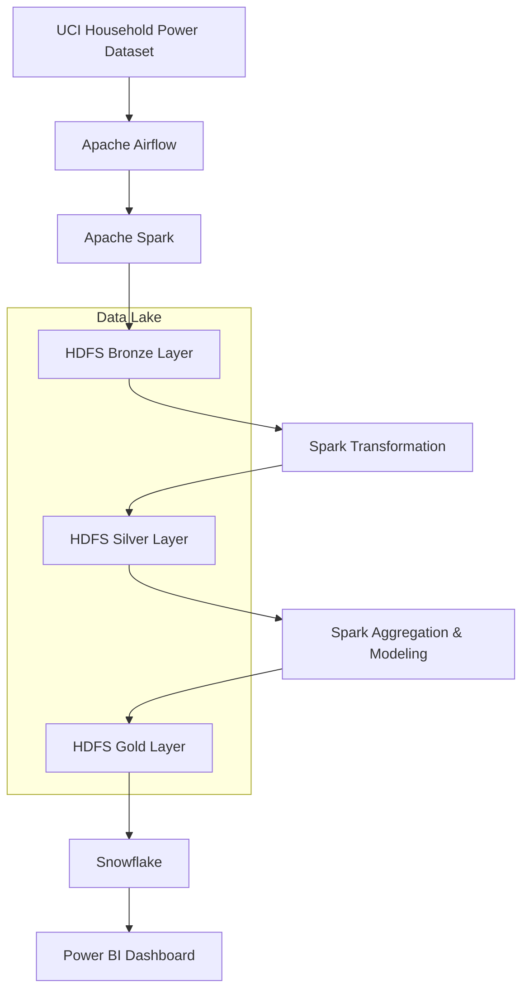

# Power Consumption ETL Pipeline

<p align="center">
  <strong>An end-to-end batch data engineering pipeline for household electricity consumption analytics.</strong>
</p>

<p align="center">
  
  
  
  
  
  
</p>

<p align="center">
  <a href="https://github.com/yousef-140/power-consumption-etl">Repository</a>
  ·
  <a href="https://archive.ics.uci.edu/ml/datasets/individual+household+electric+power+consumption">Dataset</a>
  ·
  <a href="https://yousef-140.github.io/">Portfolio</a>
</p>

---

## Overview

This project implements a batch ETL pipeline that processes household electricity consumption data and transforms raw records into structured, analytics-ready datasets.

The pipeline uses Apache Airflow for orchestration, Apache Spark for distributed data processing, HDFS for data lake storage, and Snowflake as the analytical data warehouse.

The final datasets support electricity consumption analysis through Power BI dashboards.

## Architecture



## Technology Stack

| Technology | Purpose |
|---|---|
| Python | Pipeline development and data processing |
| Apache Airflow | Workflow orchestration |
| Apache Spark | Distributed data transformation |
| HDFS | Data lake storage |
| YARN | Cluster resource management |
| Snowflake | Analytical data warehouse |
| Power BI | Data visualization and reporting |
| Docker Compose | Local infrastructure orchestration |
| Parquet | Columnar data storage |

## Data Engineering Workflow

### 1. Extraction — Bronze Layer

- Reads household electricity consumption records.
- Processes the input data in batches of 1,000 rows.
- Writes extracted batches to HDFS in Parquet format.
- Preserves the raw ingestion layer for subsequent processing.

### 2. Transformation — Silver Layer

Spark processes the extracted data through cleaning and feature engineering.

Main operations include:

- Handling null and invalid records.
- Parsing and processing timestamps.
- Extracting temporal features:
  - Hour
  - Day
  - Month
  - Year
  - Day of week
  - Weekend indicator
  - Peak-hours indicator
- Calculating total sub-metering consumption.
- Writing transformed datasets to the Silver layer.

### 3. Loading — Gold Layer

The pipeline prepares analytical datasets from the transformed records.

**FACT_POWER**

Contains electricity consumption measurements for analytical queries.

**TIME_DIM**

Contains time-related attributes, including hour, day, month, year, and weekend information.

The resulting Gold datasets are stored in HDFS and loaded into Snowflake for downstream analytics.

## Data Lake Design

| Layer | Description | Format |
|---|---|---|
| Bronze | Extracted source records | Parquet |
| Silver | Cleaned and transformed records | Parquet |
| Gold | Analytics-ready fact and dimension datasets | Parquet |

## Infrastructure

The project uses Docker Compose to organize its local infrastructure.

The environment includes:

- Apache Airflow: Webserver, Scheduler, and Triggerer.
- Apache Spark: Data processing through a PySpark environment.
- HDFS: NameNode and two DataNodes.
- YARN: ResourceManager and two NodeManagers.
- PostgreSQL: Airflow metadata database.

## Dashboard & Analytics

Power BI is used to explore electricity consumption patterns through:

- Average power consumption by month.
- Power consumption by hour.
- Weekend versus weekday comparisons.
- Year-based filtering.

The dashboard provides an analytical view of consumption trends across different time periods.

## Dataset

**UCI Individual Household Electric Power Consumption Dataset**

Source: [UCI Machine Learning Repository](https://archive.ics.uci.edu/ml/datasets/individual+household+electric+power+consumption)

The original dataset is approximately 126 MB and is not included in this repository.

Download the dataset from the original source and place it in the input location expected by the extraction code.

## Repository Structure

```text
power-consumption-etl/
│
├── dags/                  # Airflow DAGs and pipeline tasks
├── data/
│   └── raw_power_batches/ # Extracted batch data
├── logs/                  # Pipeline logs
├── notebooks/             # Development notebooks
│
├── docker-compose.yaml    # Infrastructure configuration
├── pipeline_diagrams.md   # Pipeline architecture diagrams
├── dashboard .pdf         # Power BI dashboard export
├── test.py                # Project test script
├── .gitignore
└── README.md
```

## Key Engineering Concepts

This project demonstrates practical implementation of:

- Batch ETL processing.
- Workflow orchestration with Apache Airflow.
- Distributed data processing with Apache Spark.
- HDFS-based data lake architecture.
- Bronze, Silver, and Gold data organization.
- Parquet-based storage.
- Analytical data modeling.
- Snowflake data warehouse integration.
- Business intelligence and dashboard development.

## Limitations & Future Improvements

The project is a learning and portfolio implementation. It is not presented as a production-ready data platform.

Potential improvements include:

- Automated data quality validation.
- Unit and integration testing.
- Pipeline retry and failure-handling improvements.
- Structured logging and monitoring.
- Incremental processing and idempotent loading.
- Documentation of Snowflake schema and deployment configuration.

## Author

**Yousef Reda**

AI & Data Engineering

- GitHub: [@yousef-140](https://github.com/yousef-140)
- Portfolio: [yousef-140.github.io](https://yousef-140.github.io/)
- LinkedIn: [Yousef Reda](https://www.linkedin.com/in/yousef-hassan-85a5a9296)

---

<p align="center">
  <i>Building reliable data workflows, one pipeline at a time.</i>
</p>
